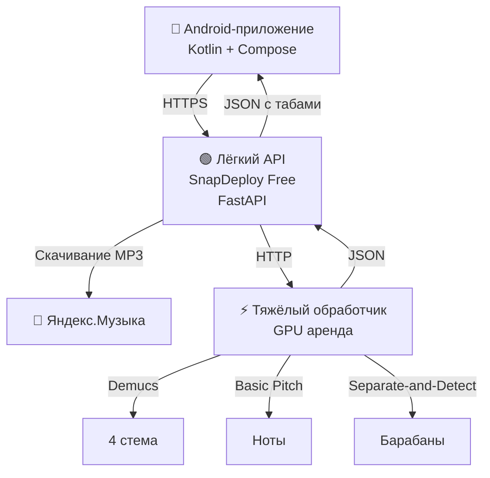

# 🎸 TabPlayer — Мастер-план проекта

> **Цель:** Мобильное приложение для полного разбора треков на табулатуры всех инструментов, с регулировкой скорости, рекомендациями по звуку и синхронизацией бегунка.
>
> **Философия:** Минимум затрат, максимум функциональности, постепенные итерации.
>
> **Обновлено:** 13.10.2026

---

## 📊 Общий прогресс

| Фаза | Прогресс | Статус | Срок |
|---|---|---|---|
| Фаза 0. Фундамент | 100% | ✅ Завершена | 12.10.2026 |
| Фаза 1. Разбор на GPU | 5% | 🔄 В работе | 13–15.10 |
| Фаза 2. Все инструменты | 0% | ⏳ Ожидает | 16–20.10 |
| Фаза 3. Функции плеера | 15% | 🔄 В работе | 21–27.10 |
| Фаза 4. Авторизация | 0% | ⏳ Ожидает | 28–31.10 |
| Фаза 5. Финальный дизайн | 40% | 🔄 В работе | постоянно |

---

## 🏗️ Архитектура



### 🔄 Жизненный цикл разбора

1. Пользователь ищет трек → Яндекс.Музыка
2. Выбирает трек → отправка `track_id` на лёгкий API
3. Лёгкий API скачивает MP3 → отправляет на GPU-сервер
4. GPU-сервер разбирает → возвращает JSON с табами
5. Лёгкий API **удаляет MP3** → хранит только JSON
6. Приложение получает результат
7. GPU-сервер **автоматически выключается** (экономия)

---

## ✅ ФАЗА 0. Фундамент (ЗАВЕРШЕНА)

### Android-приложение

- [x] Android Studio, клонирование репозитория
- [x] GitHub Actions (автосборка APK)
- [x] Экраны: плеер, табы, поиск
- [x] Разрешения: `INTERNET`, `READ_MEDIA_AUDIO`
- [x] Воспроизведение MP3 (ExoPlayer)
- [x] Слайдер и кнопки управления

### Табулатура

- [x] Сетка 4 струны (E A D G)
- [x] Номера ладов
- [x] Курсор-медиатор с подсветкой нот
- [x] Штили и рёбра (как в Guitar Pro)
- [x] Разрывы струн под нотами
- [x] 4 ряда × 2 такта на экране
- [x] Разметка долей

### Дизайн

- [x] Палитра Studio Amber
- [x] Круглые кнопки с иконками
- [x] Свечение линий
- [x] Стилизованная шапка

### Сервер (лёгкий API)

- [x] Развёртывание на SnapDeploy Free
- [x] FastAPI с эндпоинтами
- [x] Интеграция с `yandex-music`
- [x] Работающий поиск

---

## 🔄 ФАЗА 1. Разбор на GPU (13–15 октября)

**Цель:** GPU-сервер разделяет трек на инструменты и распознаёт ноты.

### Задачи

- [ ] **1.1.** Арендовать GPU-сервер
  - CloudCompute.ru (RTX 3090, от 14,4 ₽/час)
  - Или Timeweb Cloud (Tesla T4)
- [ ] **1.2.** Настроить Docker + NVIDIA Container Toolkit
- [ ] **1.3.** Создать `Dockerfile.gpu` на базе `nvidia/cuda:12.1`
  - Пакеты: `demucs`, `basic-pitch`, `libretta`, `madmom`
- [ ] **1.4.** Тестовый разбор на 2–3 треках
  - Разделение на стемы: bass, drums, vocals, other
  - MIDI для баса
  - Замерить время обработки
- [ ] **1.5.** Исправить скачивание из Яндекса
  - `tracks_download_info(track_id, get_direct_links=True)`
  - Или через `yt-dlp`
- [ ] **1.6.** Связать лёгкий API и GPU
  - `/process` — принимает track_id
  - `/status/{task_id}` — статус
  - `/result/{task_id}` — готовые табы

### 📝 Заметки

> _Цены, время обработки, ошибки_

---

## ⏳ ФАЗА 2. Мультиинструментальность (16–20 октября)

**Цель:** Все инструменты с переключением партитуры.

### Задачи

- [ ] **2.1.** Расширить модель `TrackAnalysis`

  ```kotlin
  data class TrackAnalysis(
      val title: String, val bpm: Int, val key: String,
      val tuning: String, val bass: TabTrack?,
      val guitar: TabTrack?, val drums: DrumTrack?,
      val vocals: TabTrack?, val keys: TabTrack?
  )
  ```

- [ ] **2.2.** Разбор баса (Demucs → Basic Pitch)
- [ ] **2.3.** Разбор гитары (Demucs → Basic Pitch)
- [ ] **2.4.** Разбор барабанов (Separate-and-Detect)
  - Kick, Snare, Hi-hat, Toms, Crash, Ride
- [ ] **2.5.** Разбор вокала (Basic Pitch)
- [ ] **2.6.** Разбор клавишных (из стема `other`)
- [ ] **2.7.** Распознавание BPM и тональности
  - `librosa.beat.beat_track()` для BPM
  - `librosa.feature.chroma_cqt()` для ключа
- [ ] **2.8.** Пайплайн через `libretta`
- [ ] **2.9.** UI переключения инструмента (вкладки сверху)
- [ ] **2.10.** Асинхронная очередь задач с прогрессом

### 📝 Заметки

> _Точность распознавания, время по инструментам_

---

## 🔄 ФАЗА 3. Функции плеера (21–27 октября)

### Задачи

- [x] **3.1.** Базовый плеер с перемоткой
- [ ] **3.2.** Регулировка скорости 10–150% (шаг 10%)
  - `ExoPlayer.setPlaybackParameters()`
- [ ] **3.3.** Точная синхронизация бегунка
  - Источник истины — `player.currentPosition`
  - Учёт `playbackParameters.speed`
- [ ] **3.4.** Метроном
- [ ] **3.5.** Зацикливание отрезка
- [ ] **3.6.** Рекомендации по усилителю
  - JSON: amp, gain, bass, mid, treble, effects, notes
- [ ] **3.7.** Избранное (Room DB)
- [ ] **3.8.** Экспорт в Guitar Pro (.gp5)

---

## ⏳ ФАЗА 4. Авторизация (28–31 октября)

### Задачи

- [ ] **4.1.** OAuth Яндекс
  - Регистрация на `oauth.yandex.ru`
  - WebView для входа
  - Хранение в EncryptedSharedPreferences
- [ ] **4.2.** Удаление аудио после разбора
  - MP3 в `/tmp` → удалить → хранить только JSON
- [ ] **4.3.** Хранение результатов
  - DockerHosting.ru Pro (199 ₽/мес)
  - SQLite + JSON-файлы
- [ ] **4.4.** Публикация (RuStore, F-Droid)
- [ ] **4.5.** Документация для пользователей

---

## 🎨 ФАЗА 5. Дизайн (постоянно)

### Задачи

- [x] Палитра Studio Amber
- [x] Тёмная тема
- [ ] Анимации переходов
- [ ] Иконки инструментов
- [ ] Экран настроек
- [ ] Splash screen
- [ ] Логотип
- [ ] Светлая тема (опционально)

---

## 🛠️ ТЕХНИЧЕСКИЕ ЗАМЕТКИ

### Android

- Kotlin 2.0.20, Compose BOM 2024.09
- Media3 ExoPlayer 1.3.1
- OkHttp 4.12 + Gson 2.11
- GitHub Actions, Gradle 8.7

### Лёгкий API

- Python 3.10, FastAPI
- `yandex-music`, `yt-dlp`
- SnapDeploy Free (512 МБ RAM, 5 деплоев/12ч)
- Порт 8000, Root Directory пусто

### Тяжёлый обработчик

- CloudCompute.ru / Timeweb Cloud
- Почасовая аренда (~14 ₽/час)
- GPU Tesla T4 / RTX 3090
- Docker `nvidia/cuda:12.1.0`
- Порт 8001

### Хранение

- DockerHosting.ru Pro (199 ₽/мес)
- SQLite + JSON

---

## 🚧 ИЗВЕСТНЫЕ ПРОБЛЕМЫ

| Проблема | Решение | Статус |
|---|---|---|
| `Invalid server response` | `get_direct_links=True` / `yt-dlp` | 🔄 |
| Лимит 5 деплоев/12ч | Автодеплой + отключение | ✅ |
| Нет GPU на SnapDeploy | Переезд на CloudCompute | ⏳ |
| Docker-кэш | Удаление контейнера | ✅ |
| Порт 8080 vs 8000 | `EXPOSE 8000` | ✅ |
| Русская раскладка | Отключить автозамену | ✅ |

---

## 💡 ИДЕИ НА БУДУЩЕЕ

- [ ] Веб-версия
- [ ] Синхронизация между устройствами
- [ ] Запись своей игры
- [ ] Сообщество (обмен табами)
- [ ] AI-ассистент для аппликатур
- [ ] MIDI-редактор
- [ ] Виртуальный усилитель

---

## 📅 КАЛЕНДАРЬ

| Дата | Событие | Статус |
|---|---|---|
| 12.10 | Завершение Фазы 0 | ✅ |
| 13.10 | Старт Фазы 1 | 🔄 |
| 14.10 | Аренда GPU, первый разбор | ⏳ |
| 15.10 | Интеграция GPU ↔ SnapDeploy | ⏳ |
| 16–20.10 | Фаза 2 | ⏳ |
| 21–27.10 | Фаза 3 | ⏳ |
| 28–31.10 | Фаза 4 | ⏳ |

---

## 📝 ЖУРНАЛ ИЗМЕНЕНИЙ

### 13.10.2026

- Создан мастер-план
- Завершена Фаза 0
- Сервер SnapDeploy работает, поиск в Яндексе успешен
- Старт Фазы 1: аренда GPU

### 12.10.2026

- План проекта (v1)
- GitHub Actions для APK
- Палитра Studio Amber

---

## 🎯 ТЕКУЩИЕ ЗАДАЧИ

> **СЕЙЧАС:** Фаза 1.1 — аренда GPU-сервера

1. ⬜ Арендовать Tesla T4 на CloudCompute.ru (2 часа)
2. ⬜ Настроить Docker + NVIDIA Toolkit
3. ⬜ Создать `gpu_main.py` с `/analyze`

### Вопросы

- Хватит ли 16 ГБ VRAM для Demucs + S&D?
- Сколько времени займёт разбор 3-минутного трека?
- Как автоматизировать вкл/выкл GPU-сервера?
